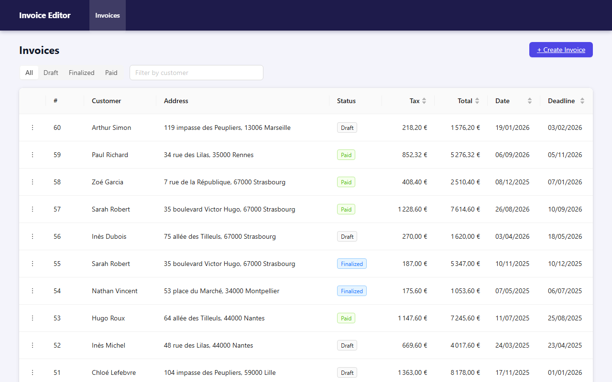
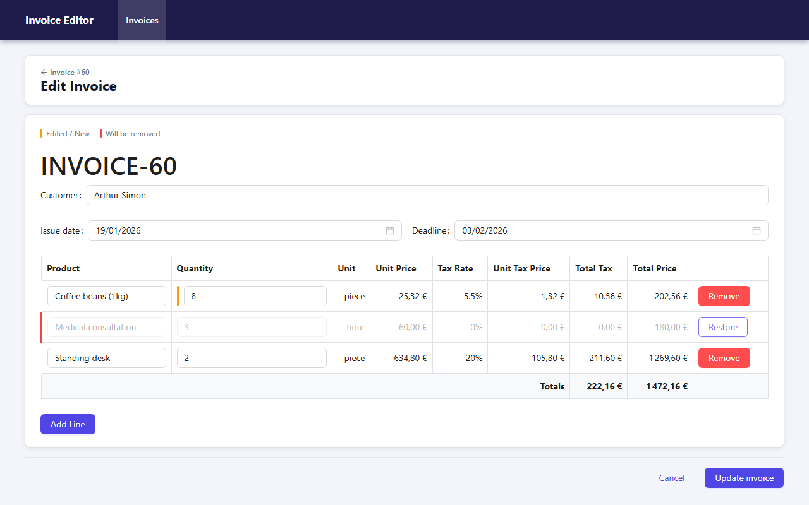
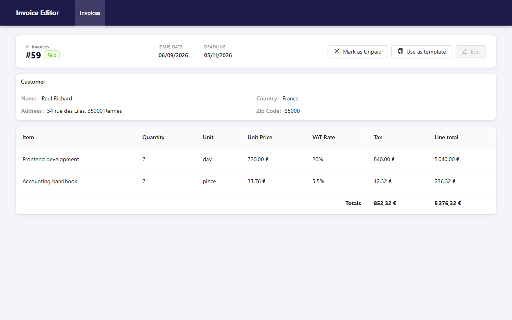

# Invoice Editor

[](https://github.com/Knightly95/invoice-editor/actions/workflows/deploy.yml)
[](#tests-and-coverage)

**[▶ Live demo](https://knightly95.github.io/invoice-editor/)**: runs entirely in your browser with demo data. No sign-up is needed.

> **Background:** I built this project as a take-home for a frontend technical assessment in a hiring process, then moved it to my personal account. When I did that, I replaced the original hosted API with a built-in mock and squashed the history into one commit. You can find the original commit-by-commit history in [HISTORY.md](HISTORY.md).

A React + TypeScript app for creating, editing, finalizing and tracking invoices. It's built for accountants and finance teams: amounts must be exact, invoice states must be explicit, and every action gets clear feedback.

It runs **out of the box with no backend**. An in-browser mock API (built on [MSW](https://mswjs.io/)) serves seeded demo data and saves your changes in `localStorage`.


## Screenshots

| Invoice list | Editing an invoice |
| --- | --- |
| [](docs/screenshots/invoice-list.png) | [](docs/screenshots/invoice-edit.png) |
| Filter by status or customer, sort and page. The state lives in the URL. | A changed field is marked in orange and a line to be removed in red, before anything is saved. |

[](docs/screenshots/invoice-detail.png)

A finalized invoice is locked: it can be marked as paid or unpaid, or used as a template.

## Features

- **Invoice list**: server-side pagination, sorting by total, tax, date or deadline, status filter (draft / finalized / paid) and a customer filter. All state lives in the URL, so views can be shared.
- **Create and edit invoices**: customer and product autocomplete with infinite scroll, invoice lines, live totals and VAT, and Yup validation (for example, the deadline can't be before the issue date).
- **Editing safeguards**: changed fields and removed lines are highlighted, and leaving with unsaved changes asks for confirmation.
- **Invoice lifecycle**: finalize, mark as paid or unpaid, and delete. Finalized invoices are locked, as they would be in real bookkeeping.
- **Use as template**: start a new invoice from an existing one.
- **Toast feedback** on every mutation.

## Tech stack

React 18 · TypeScript · TanStack Query v5 · React Router v7 · Ant Design v5 · React Hook Form + Yup · big.js (exact money arithmetic) · dayjs · openapi-client-axios · Jest + React Testing Library + MSW

## Getting started

Prerequisites: Node 22 and Yarn 1 (see `.tool-versions`).

```bash
yarn install
yarn start      # http://localhost:3000
yarn test       # unit + integration tests
yarn build      # production build in ./build
```

## Tests and coverage

```bash
yarn test              # unit and integration tests
yarn test --coverage   # the same, with a coverage report in ./coverage
```

The tests use Jest, React Testing Library and MSW. CI measures line coverage on every push to `main` and publishes the number shown in the badge above.

## API

The API contract is defined in [`src/api/schema.yml`](src/api/schema.yml) (OpenAPI 3). A typed client is generated from it (`yarn openapi:gen`) and exposed through the `useApi()` hook.

| Method | Path                | Description                                                      |
| ------ | ------------------- | ---------------------------------------------------------------- |
| GET    | `/invoices`         | List invoices (`page`, `per_page`, `filter`, `sort`)             |
| POST   | `/invoices`         | Create an invoice with its lines                                 |
| GET    | `/invoices/:id`     | Get one invoice                                                  |
| PUT    | `/invoices/:id`     | Update an invoice; lines via `invoice_lines_attributes`          |
| DELETE | `/invoices/:id`     | Delete a draft invoice                                           |
| GET    | `/customers/search` | Search customers                                                 |
| GET    | `/products/search`  | Search products                                                  |

`filter` is a JSON array of `{ field, operator, value }`, for example `[{"field":"paid","operator":"eq","value":true}]`. Supported operators: `eq`, `not_eq`, `gt`, `gteq`, `lt`, `lteq`, `in`, `not_in`. `sort` is a comma-separated list such as `-total,+date`.

Business rules: once an invoice is finalized, only `paid` can change. Only finalized invoices can be marked as paid, and finalized invoices can't be deleted. Line `price` and `tax` and invoice `total` and `tax` are always derived from the current product prices.

### Mock API (default)

The mock lives in [`src/mockApi`](src/mockApi):

- `seed.ts`: deterministic demo data (40 customers, 25 products, 60 invoices)
- `handlers.ts`: MSW handlers implementing the endpoints and business rules above
- `store.ts`: persistence in `localStorage`

To reset the demo data, run `localStorage.removeItem('invoice-editor:mock-db:v1')` in the browser console and reload.

### Using a real backend

Create a `.env.local` file:

```dotenv
REACT_APP_API_URL=https://your-api.example.com
REACT_APP_API_TOKEN=your-token   # sent as the X-SESSION header
```

When `REACT_APP_API_URL` is set, the mock API is not started.

### Quality checks

A second CI job builds the app and checks what visitors get:

- **Lighthouse** (mobile settings): the build fails if accessibility drops below 95 or best practices below 90; performance and SEO are reported. Last run: performance 73, accessibility 100, best practices 100, SEO 91. Performance is lower because Ant Design is a large library; it is reported, not enforced.
- **Bundle budget:** the JavaScript sent to the browser must stay under 600 kB gzip (today: 569.8 kB). To check locally: `yarn build && node bin/bundle-budget.mjs build 600`.

The Lighthouse report is attached to each CI run.

## Deployment

Every push to `main` is type-checked, tested and deployed to GitHub Pages by [`.github/workflows/deploy.yml`](.github/workflows/deploy.yml).

The build is a fully static site, mock API included, so it can be deployed to any static host (Cloudflare Pages, Netlify, Vercel, GitHub Pages and so on). Configure your host to serve `index.html` for unknown routes, because the app uses client-side routing.

```bash
yarn build
npx wrangler pages deploy build   # Cloudflare Pages example
```

## Documentation

- [`CONTRIBUTING.md`](CONTRIBUTING.md): setup, checks, conventions and how to propose a change.
- [`AGENTS.md`](AGENTS.md): commands, rules and guardrails for AI coding agents.
- [`ADR.md`](ADR.md): architecture and process decisions, including how AI tooling was used and validated.
- [`DECISIONS.md`](DECISIONS.md): a detailed log of non-trivial implementation choices and their trade-offs.
- [`HISTORY.md`](HISTORY.md): the original commit-by-commit development history.
- [`backend_issues.md`](backend_issues.md): API bugs found during development and the frontend workarounds for them.
